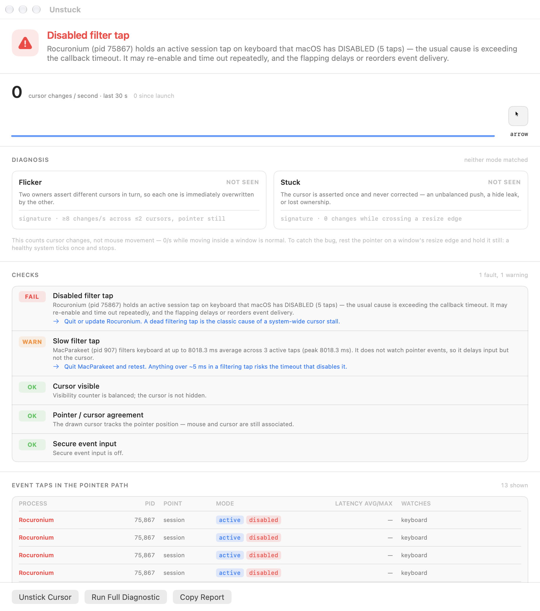

# Unstuck

Unstuck identifies processes fighting over the Mac’s cursor and repairs stuck or flickering cursor shapes in place, without restarting WindowServer or logging out.

[Source](https://github.com/kageroumado/unstuck)

## Highlights

- Identify processes competing over the cursor and inspect their event taps.
- Repair cursor state in place while keeping the current desktop session.

Full feature list

- Cursor-change and event-tap inspection.
- Reset cursor hide state, pointer association, and image registration.
- Repair stuck or flickering cursor shapes without restarting WindowServer or logging out.

## Notes

- macOS 14+; build with `./build.sh`.
